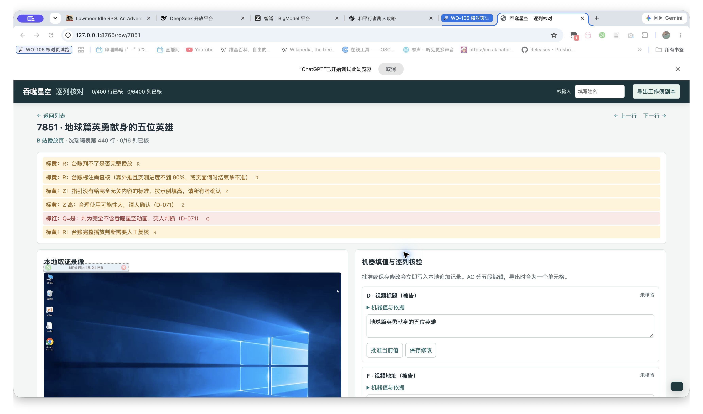
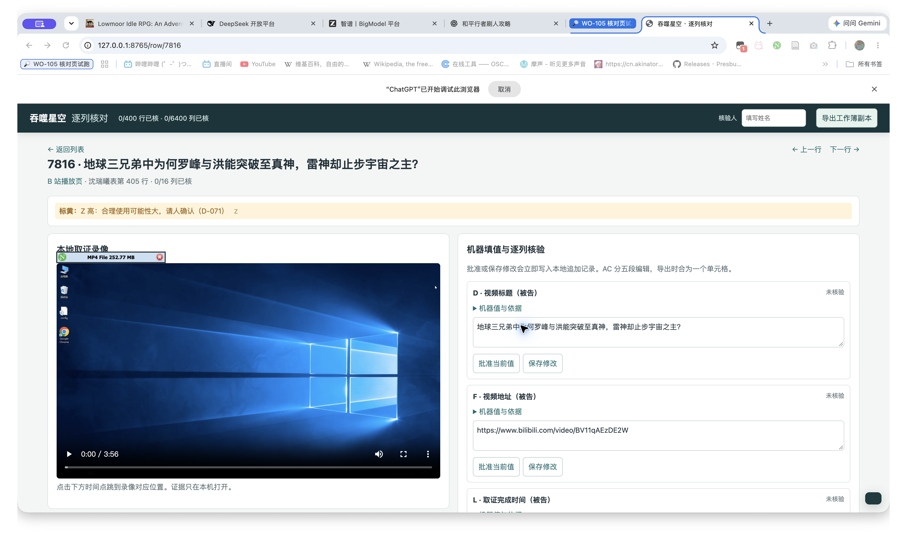
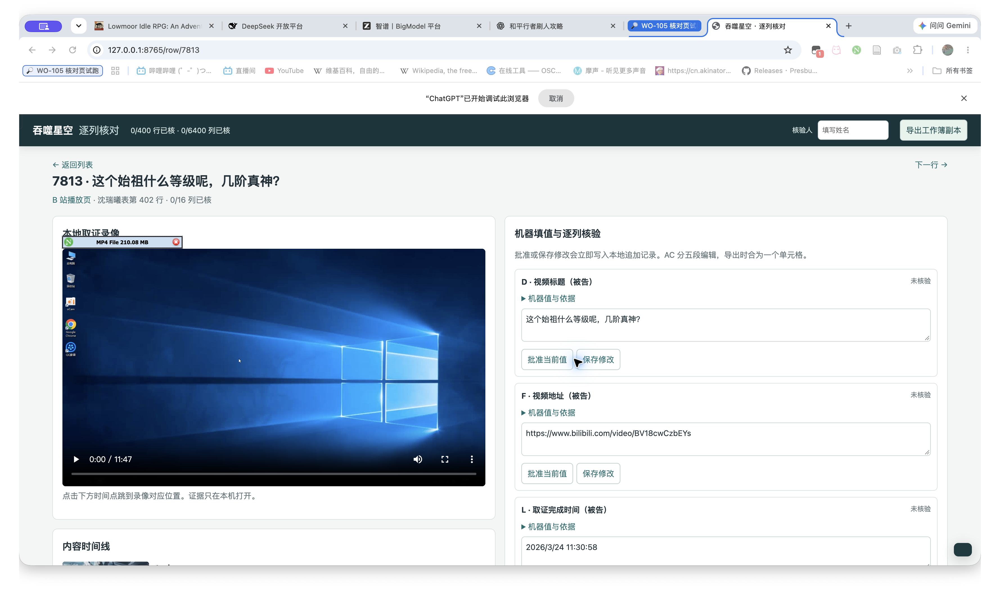

# WO-105 交付说明

- **独立审计**：本地只读扫描 7813–8212 共 400 行，发现 33 项待核线索，涉及 30 行；逐行清单在 `workspace/tsxk/audit/findings.csv`，按类型、各取两例的汇总在 `workspace/tsxk/audit/summary.md`。其中 W 与新增画面描述不一致 17 行（含 Owner 指出的 7874）；U/Y 9 行；T/AC 形式 2 行；小说证据 2 行；偷渡时间段、仅增 BGM、Z/意见各 1 行。这些是核验线索，未改 `rows/`。
- **真实核对与导出**：页面仅绑定 `127.0.0.1:8765`，红 7851、黄 7816、正常 7813 均在 Chrome 打开；正式核验记录未创建。临时目录导出后，openpyxl 逐格检查“沈瑞曦”表：目标 6,400 格，3,023 个标黄标红格的颜色与批注一致；其余格值、类型、样式无差异。其他工作表和 OOXML 部件以原始字节核对，均未变；原表 SHA-256 前后同为 `632f1f745a8cdc7c4644d0fd045daf1ed46d8c1473b4ba4b6aa103c81884fbb1`。导出说明列出 400 行未核验列。未读“张亚晨”结论。
- **测试与集成**：`pilot/audio/test_tsxk_r1.py` 的两项调用已适配 `speech_selection(clauses, played)`，声音相关 12 项通过。`tsxk/integration` 从 main 切出，依次合并 wo-102、wo-103、wo-104，均无冲突；未合并 main。主仓库 `.venv` 已装 Playwright 1.60.0。显式收集 `tests/` 与 `pilot/` 后，全仓 396 项通过、1 项因缺 ffmpeg/OCR 工具跳过，另有 11 个子测试通过。
- **后续**：Owner 按审计清单判断是否需要更正 30 行的机器草稿，再逐列核验。工作簿试跑副本仅在系统临时目录；未改原表，未 push。

| 标红 7851 | 标黄 7816 | 正常 7813 |
|---|---|---|
|  |  |  |
